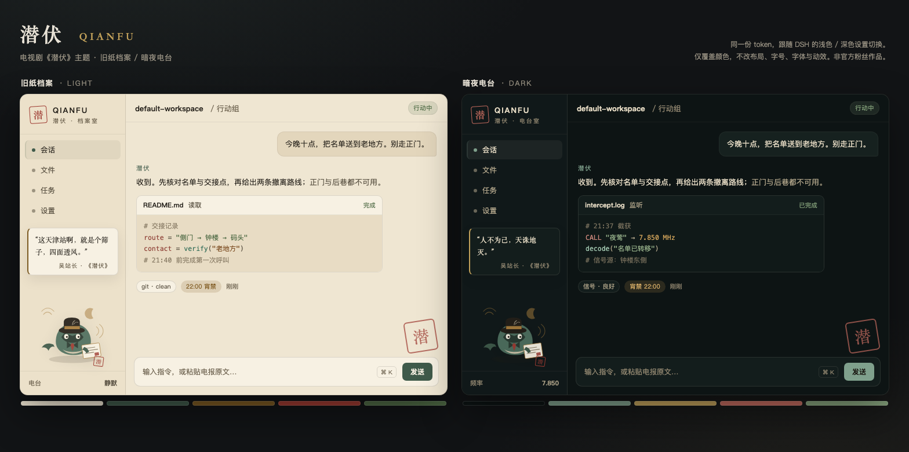

# 潜伏 QIANFU

[English](./README.md) | 中文

> 电视剧《潜伏》主题的 DeepSeek Harness Web 主题插件：旧纸、墨绿、黄铜与印章红，明暗双生。
>
> 非官方粉丝作品，与《潜伏》版权方及 DeepSeek 均无关联；不含剧照、Logo 或任何受版权保护的素材。



## 两套配色

| 模式 | 名称 | 气质 |
| --- | --- | --- |
| 浅色 | **旧纸档案** | 泛黄的电报纸、铁胆墨水、墨绿西装、黄铜包角，印章红只用于警示 |
| 深色 | **暗夜电台** | 凌晨三点的电台室：近黑墨绿、烟青台面、黄铜旋钮、压暗的绛红 |

主题不替换内置明暗主题，而是通过官方的 `ctx.theme.overrideTokens()` 叠一层 **别名 token**。因此：

- 你在「设置 → 外观」里选浅色 / 深色 / 跟随系统，主题会自动在「旧纸档案」和「暗夜电台」之间切换；
- 字号、字体、终端字体等设置完全不受影响；
- 卸载或禁用插件时，这层调色板随插件一起移除，不会留下 CSS 或 profile 补丁。

## 侧栏与吉祥物

macOS 的原生侧栏默认是透明的（窗口 vibrancy），会露出灰色窗口，和纸色正文割裂。0.2.0 起主题把这块侧栏也铺成纸色，并在底部挂了一只原创的「潜伏鲸」：礼帽、风衣领、红领带、电报和印章红。

鲸鱼上方是一张「站长金句」小卡，点击换一句，选择记在浏览器本地。目前收录 6 句短引用：

> 这天津站啊，就是个筛子，四面透风。
>
> 则成啊，你是我的人，明白吗？
>
> 人不为己，天诛地灭。

台词版权归剧方所有，这里只做粉丝向的短引用。想关闭：把 `lib/client.js` 里的 `QUOTES` 改成 `[]`，重新打包/安装即可。

卡通形象为原创，不含剧照、演员肖像或剧集 Logo。

## 安装

### DSH Desktop（推荐）

1. 打开 **设置 → 插件**
2. 点 **安装插件**
3. 插件包名填本目录的绝对路径，例如：

```text
/Users/apple/Documents/deepseek-harness/default-workspace/dsh-theme-qianfu
```

4. 安装完成后按提示重启 / 刷新 DSH
5. 在 **设置 → 外观** 里切换浅色 / 深色，即可看到两套配色

### Web profile（CLI）

从 GitHub 安装：

```sh
dsh plugin --profile web add github:zshao56/dsh-theme-qianfu
dsh web
```

从本地目录安装：

```sh
dsh plugin --profile web add /absolute/path/to/dsh-theme-qianfu
dsh web
```

装完硬刷新浏览器（`Cmd/Ctrl + Shift + R`）。

### 从 tarball 安装

```sh
cd dsh-theme-qianfu
npm pack
# 得到 dsh-theme-qianfu-0.3.0.tgz
dsh plugin --profile web add /absolute/path/to/dsh-theme-qianfu-0.3.0.tgz
```

## 兼容性

- 需要 DSH **0.2.0-rc.2+**（`ctx.theme.overrideTokens` 的稳定接口）
- 已在 DSH `0.2.1-rc.2` 的 Desktop 组合上测试
- 纯客户端插件：`platform: "web"`，不注册任何模型工具、不发起网络请求、不写 profile

## 开关与卸载

- **临时关闭**：设置 → 插件 → 找到「潜伏 QIANFU」→ 停用；调色板层会随插件卸载立即消失
- **彻底卸载**：同一张卡片上点移除，然后重启 / 刷新

## 开发

```sh
npm test               # 契约测试 + 关键文字/背景的 WCAG 对比度检查
open preview.html      # 用真实 token 渲染的浅色/深色预览
```

`preview.html` 直接加载 `lib/client.js`，从插件里读出 token 再绘制预览，所以预览不会和实现漂移。

## 设计约束

- 颜色全部通过 `--dsw-alias-*` / `--dsw-specific-*` token 表达，不写组件选择器，不覆盖布局
- 正文、次级文字、三级文字、链接、状态色与按钮文字的对比度均 ≥ 4.5:1（浅色与深色各自验证）
- 只改颜色，不改字号、字体、圆角、阴影和动效

## License

MIT
